<div align="center">

# BoundEvo

**Adaptive Boundary Evolutionary Optimization**

A compact, reproducible Python implementation of real-coded multi-parent evolutionary optimization with adaptive-boundary coefficient generation.

[](https://github.com/ZJY-HSBL/BoundEvo/actions/workflows/ci.yml)


[中文说明](README_CN.md) · [Algorithm](docs/algorithm.md) · [Reproduction](docs/reproduction.md) · [Research Workflow](docs/research_workflow.md) · [Run Registry](docs/run_registry.md) · [v0.10.0 Notes](docs/releases/v0.10.0.md)

</div>

<!-- BENCHMARK_RESULTS_START -->
## Measured CEC2017 results — 30D

**Real runs, not simulated:** D=30, 3,000 function evaluations per run, 10 paired initial seeds per method, 120 independent optimization trials. ABC, EDBF, and RE share the same initial population for each function/repetition pair.

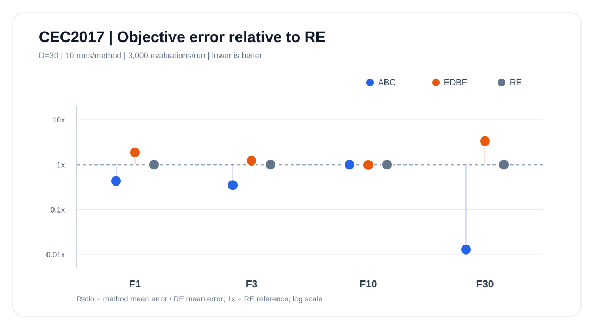

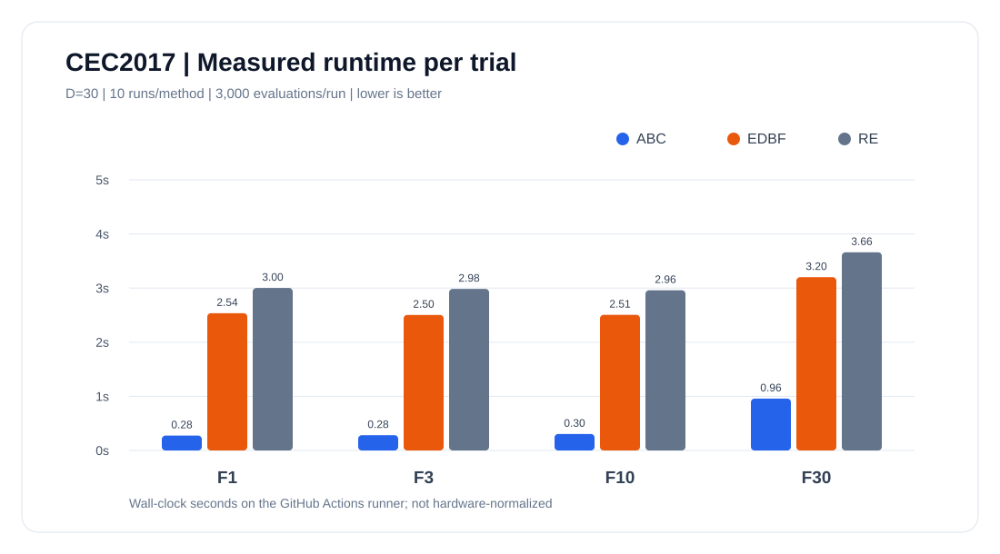

**Mean final objective error (lower is better)**

| Function | ABC | EDBF | RE |
|:---|---:|---:|---:|
| F1 | **1.747e+11** | 7.536e+11 | 4.038e+11 |
| F3 | **84,611.2** | 294,908.6 | 241,204.0 |
| F10 | 8,157.7 | **8,047.6** | 8,174.2 |
| F30 | **4.884e+06** | 1.262e+09 | 3.776e+08 |

Source: [raw trials](docs/experiments/cec2017-reference-30d-2026-10-17/trials.csv) · [mean and SD](docs/experiments/cec2017-reference-30d-2026-10-17/summary.csv) · [paired tests](docs/experiments/cec2017-reference-30d-2026-10-17/paired_sign_tests.csv) · [environment](docs/experiments/cec2017-reference-30d-2026-10-17/environment.json) · [full analysis](docs/experiments/cec2017-reference-30d-2026-10-17/statistical_analysis_CN.md)

**Interpretation:** ABC has the lowest mean error on F1, F3, and F30; **EDBF is slightly better on F10**. These exploratory results do not establish universal superiority. The C-derived Python benchmark is an independent reference, not the original official C binary. The 58/58 finite/optimum preflight checks were sampled-point checks, not exhaustive validation. The 3,000-evaluation budget is much smaller than a full paper-level experiment.

### 100k evaluation budget — adaptive 20-seed continuation

**120 actual optimizer trials.** F16/F22, 30D, ABC/EDBF/RE, 20 matched seeds continued from the earlier 10k experiment. The first 5 repeats reuse the already verified 100k runs; only repeats 5–19 were newly computed.

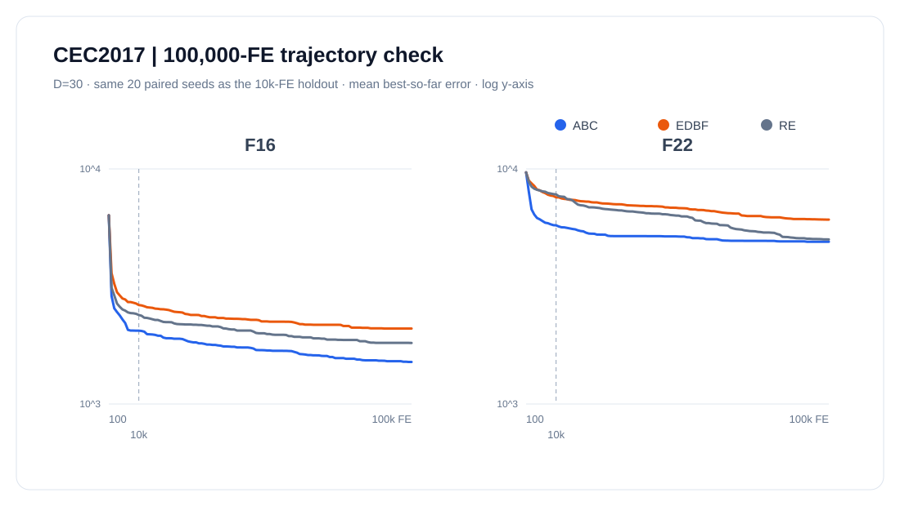

| Function | Method | 10k mean error | 100k mean error | Bootstrap 95% CI |
|:---|:---|---:|---:|:---|
| F16 | ABC | 2,050.7 | 1,509.1 | [1,362.9, 1,640.2] |
| F16 | EDBF | 2,636.3 | 2,094.0 | [2,018.6, 2,161.9] |
| F16 | RE | 2,391.3 | 1,817.9 | [1,775.1, 1,863.5] |
| F22 | ABC | 5,755.3 | 4,900.7 | [3,701.8, 6,024.3] |
| F22 | EDBF | 7,571.2 | 6,087.9 | [5,183.5, 6,830.4] |
| F22 | RE | 7,791.6 | 5,012.8 | [3,737.3, 6,205.7] |

| Function | Paired contrast | ABC wins/losses/ties | Holm-adjusted p |
|:---|:---|---:|---:|
| F16 | abc_vs_edbf | 20/0/0 | 7.62939e-06 |
| F16 | abc_vs_re | 18/2/0 | 0.00120735 |
| F22 | abc_vs_edbf | 12/8/0 | 1 |
| F22 | abc_vs_re | 9/11/0 | 1 |

**Exploratory, adaptive evidence:** the decision to extend from 5 to 20 seeds was made after seeing F22's high-variance results. These are NOT new independent test seeds; a Holm correction for four within-extension tests does not erase earlier selection.

[120 raw trials](docs/experiments/cec2017-paperbudget-30d-100k-20seeds-2026-10-19/trials.csv) · [convergence history](docs/experiments/cec2017-paperbudget-30d-100k-20seeds-2026-10-19/history.csv) · [Holm comparisons](docs/experiments/cec2017-paperbudget-30d-100k-20seeds-2026-10-19/paired_tests.csv) · [report](docs/experiments/cec2017-paperbudget-30d-100k-20seeds-2026-10-19/report.md)


### Toward the source-paper budget: 100,000 evaluations

**30 actual optimization trials** on F16/F22, D=30; ABC/EDBF/RE each use 5 seeds taken from the prior 20-seed holdout. Every 10k checkpoint must reproduce its previously measured result exactly.

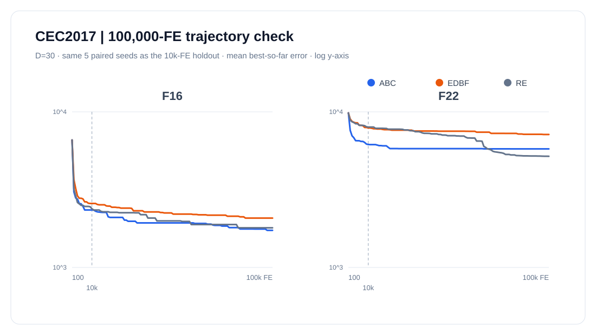

| Function | Method | 10k mean error | 100k mean error | Change |
|:---|:---|---:|---:|---:|
| F16 | ABC | 2,341.1 | 1,732.4 | +26.00% |
| F16 | EDBF | 2,577.7 | 2,076.1 | +19.46% |
| F16 | RE | 2,381.9 | 1,797.7 | +24.53% |
| F22 | ABC | 6,170.2 | 5,780.2 | +6.32% |
| F22 | EDBF | 7,879.7 | 7,155.4 | +9.19% |
| F22 | RE | 7,981.5 | 5,180.4 | +35.10% |

[30 raw 100k-FE trials](docs/experiments/cec2017-paperbudget-30d-100k-2026-10-18/trials.csv) · [actual convergence checkpoints](docs/experiments/cec2017-paperbudget-30d-100k-2026-10-18/history.csv) · [source verification](docs/experiments/cec2017-paperbudget-30d-100k-2026-10-18/environment.json) · [analysis](docs/experiments/cec2017-paperbudget-30d-100k-2026-10-18/report.md)

**Scope:** Only two functions and five matched seeds. The 100k-FE cap matches the source paper's upper budget, but this does not replicate its full 29-function experimental suite.

### F16/F22: 20 new seeds to test the unstable rankings

**120 new measured trials** on F16/F22, D=30, 10,000 function evaluations, with 20 seed values not reused in previous studies. ABC/EDBF/RE have matched initial seeds for each repeat.

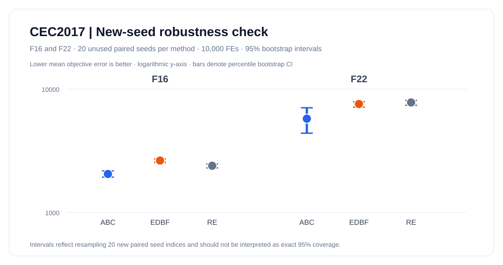

**Mean objective error and 95% percentile bootstrap interval** (lower is better):

| Function | Method | Mean error | 95% bootstrap interval |
|:---|:---|---:|:---|
| F16 | ABC | 2,050.7 | [1,934.4, 2,172.8] |
| F16 | EDBF | 2,636.3 | [2,548.6, 2,715.5] |
| F16 | RE | 2,391.3 | [2,296.2, 2,471.8] |
| F22 | ABC | 5,755.3 | [4,392.0, 7,056.6] |
| F22 | EDBF | 7,571.2 | [7,137.0, 7,890.0] |
| F22 | RE | 7,791.6 | [7,395.5, 8,097.8] |

**Observed winner sensitivity across disjoint cohorts** (do not pool across repeats):

| Function | Earlier 3 seeds | Earlier 10 seeds | New 20 seeds |
|:---|:---|:---|:---|
| F16 | RE | — | ABC |
| F22 | EDBF | ABC | ABC |

**Two-sided exact paired sign tests, Holm correction for 4 contrasts:**

| Function | Contrast | ABC W/L/T | Holm p |
|:---|:---|---:|---:|
| F16 | abc_vs_edbf | 19/1/0 | 0.00016022 |
| F16 | abc_vs_re | 16/4/0 | 0.035454 |
| F22 | abc_vs_edbf | 13/7/0 | 0.26318 |
| F22 | abc_vs_re | 14/6/0 | 0.23064 |

[120 fresh-seed raw trials](docs/experiments/cec2017-holdout-30d-10k-2026-10-17/trials.csv) · [bootstrap results](docs/experiments/cec2017-holdout-30d-10k-2026-10-17/summary.csv) · [paired hypothesis tests](docs/experiments/cec2017-holdout-30d-10k-2026-10-17/paired_tests.csv) · [experiment protocol](docs/experiments/cec2017-holdout-30d-10k-2026-10-17/environment.json) · [complete report](docs/experiments/cec2017-holdout-30d-10k-2026-10-17/report.md)

**Caveat:** The functions were selected after earlier ranking disagreements. Fresh seeds reduce data reuse but this remains an exploratory two-function study.

### All 29 functions at 10,000 evaluations (3 paired seeds)

**261 real independent optimization trials**; CEC2017 D=30; ABC, EDBF and RE start each paired repetition from the same seed. Results remain exploratory because there are just three seeds per function.

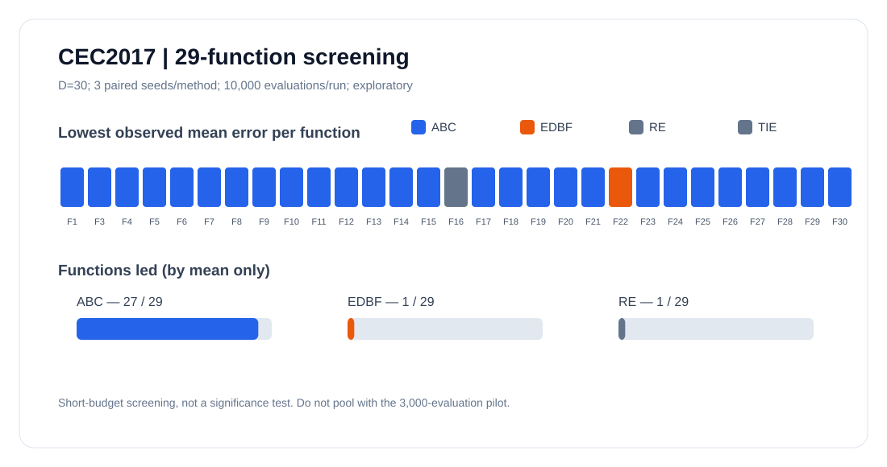

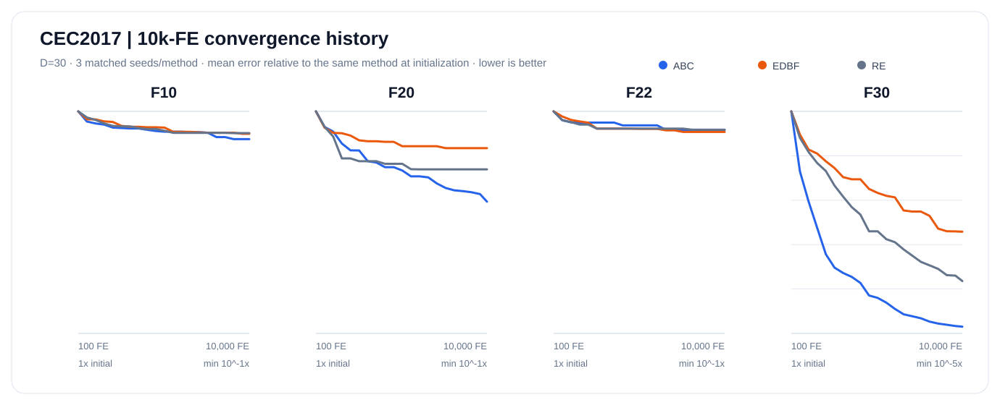

Functions with lowest observed mean error: ABC 27, EDBF 1, RE 1.

**Across-function paired Wilcoxon tests** on log10 of function-level mean errors, Holm correction across two contrasts:

| Contrast | ABC leads / trails | Raw p | Holm p |
|:---|---:|---:|---:|
| abc_vs_edbf | 28/1 | 7.4506e-09 | 1.4901e-08 |
| abc_vs_re | 28/1 | 1.1176e-08 | 1.4901e-08 |

<details><summary>See measured means for all 29 functions</summary>

| Function | ABC | EDBF | RE |
|:---|---:|---:|---:|
| F1 | **1.321e+11** | 3.331e+11 | 1.537e+11 |
| F3 | **31,980.2** | 275,529.3 | 145,773.4 |
| F4 | **915.1** | 7,212.7 | 1,048.8 |
| F5 | **279.5** | 419.5 | 317.7 |
| F6 | **48.2** | 100.6 | 71.6 |
| F7 | **441.7** | 1,754.9 | 693.4 |
| F8 | **273.2** | 402.4 | 318.5 |
| F9 | **3,853.2** | 18,373.9 | 9,431.4 |
| F10 | **7,300.6** | 7,715.9 | 7,773.1 |
| F11 | **281.8** | 3,532.0 | 691.5 |
| F12 | **2.247e+07** | 1.373e+10 | 2.408e+09 |
| F13 | **16,042.5** | 2.463e+09 | 2.624e+07 |
| F14 | **295.6** | 19,196.9 | 435.4 |
| F15 | **810.3** | 1.470e+07 | 50,695.6 |
| F16 | 2,327.5 | 2,610.2 | **2,257.3** |
| F17 | **883.3** | 1,368.5 | 1,125.7 |
| F18 | **406.7** | 5.193e+06 | 757,108.7 |
| F19 | **206.6** | 5.637e+07 | 1.350e+06 |
| F20 | **682.2** | 1,188.4 | 953.3 |
| F21 | **458.6** | 589.1 | 486.1 |
| F22 | 7,889.5 | **7,725.8** | 7,904.8 |
| F23 | **694.9** | 809.1 | 728.5 |
| F24 | **763.2** | 841.2 | 828.4 |
| F25 | **736.0** | 3,931.1 | 1,013.2 |
| F26 | **4,284.3** | 6,036.8 | 4,558.3 |
| F27 | **568.8** | 633.5 | 593.4 |
| F28 | **1,129.9** | 2,898.3 | 1,302.0 |
| F29 | **1,310.6** | 1,925.1 | 1,920.1 |
| F30 | **459,541.4** | 6.323e+07 | 4.889e+06 |

</details>


[Raw trial CSV](docs/experiments/cec2017-fullsuite-30d-10k-2026-10-17/trials.csv) · [convergence checkpoints](docs/experiments/cec2017-fullsuite-30d-10k-2026-10-17/history.csv) · [per-function metrics](docs/experiments/cec2017-fullsuite-30d-10k-2026-10-17/summary.csv) · [research report](docs/experiments/cec2017-fullsuite-30d-10k-2026-10-17/report.md) · [runtime environment](docs/experiments/cec2017-fullsuite-30d-10k-2026-10-17/environment.json)

**Scope:** This is a 10k-FE full-function exploratory benchmark, not a reproduction of the 100k-FE paper. Different evaluation budgets and different benchmark backends must never be pooled.

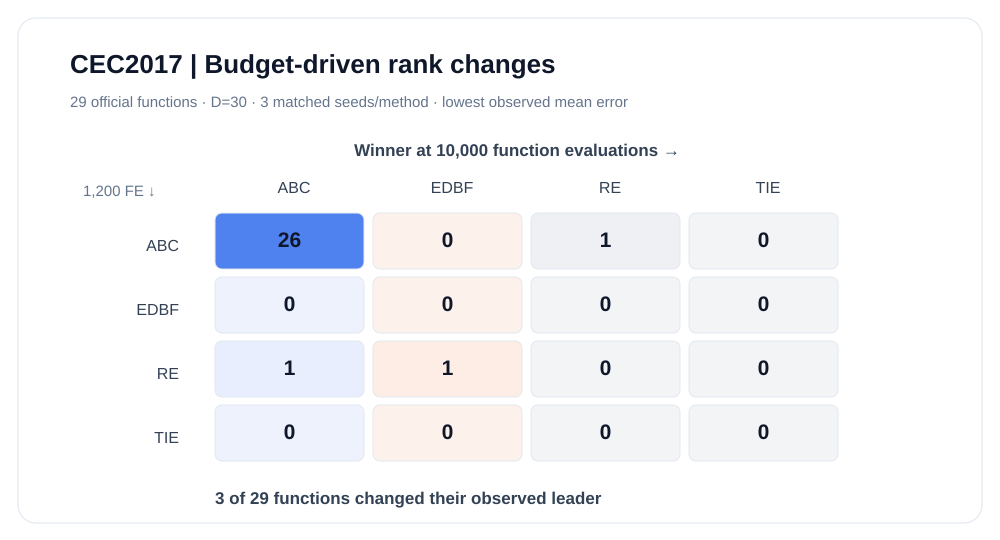

Across 29 functions, 3 changed their observed mean-error leader between 1,200 and 10,000 evaluations.


### Higher-budget verification: 10,000 evaluations

**120 measured trials** at D=30 (F10, F20, F22, F30), 10 matched initial seeds/method. The focus includes the cases where ABC did not lead in earlier experiments.

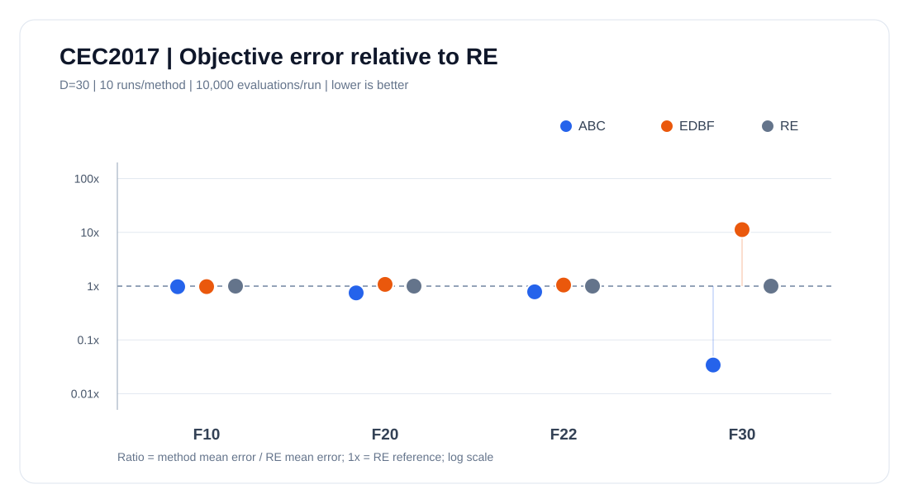

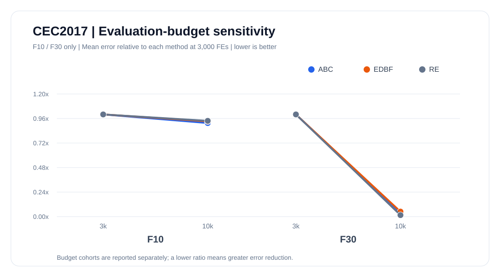

| Function | ABC | EDBF | RE |
|:---|---:|---:|---:|
| F10 | **7,470.2** | 7,501.9 | 7,661.9 |
| F20 | **785.2** | 1,129.8 | 1,049.5 |
| F22 | **5,717.6** | 7,651.5 | 7,300.1 |
| F30 | **188,044.0** | 6.193e+07 | 5.511e+06 |

**Cross-budget check** (same reference-derived backend and seed schedule; 3,000 → 10,000 evaluations):

| Function | Method | 3k FE mean error | 10k FE mean error |
|:---|:---|---:|---:|
| F10 | ABC | 8,157.7 | 7,470.2 |
| F10 | EDBF | 8,047.6 | 7,501.9 |
| F10 | RE | 8,174.2 | 7,661.9 |
| F30 | ABC | 4.884e+06 | 188,044.0 |
| F30 | EDBF | 1.262e+09 | 6.193e+07 |
| F30 | RE | 3.776e+08 | 5.511e+06 |

**Exact paired sign tests with Holm correction across 8 comparisons** (exploratory; lower error is better):

| Function | Contrast | ABC W/L/T | Raw p | Holm p |
|:---|:---|---:|---:|---:|
| F10 | ABC vs EDBF | 4/6/0 | 0.75391 | 1 |
| F10 | ABC vs RE | 5/4/1 | 1 | 1 |
| F20 | ABC vs EDBF | 10/0/0 | 0.0019531 | 0.015625 |
| F20 | ABC vs RE | 10/0/0 | 0.0019531 | 0.015625 |
| F22 | ABC vs EDBF | 7/3/0 | 0.34375 | 1 |
| F22 | ABC vs RE | 7/3/0 | 0.34375 | 1 |
| F30 | ABC vs EDBF | 10/0/0 | 0.0019531 | 0.015625 |
| F30 | ABC vs RE | 10/0/0 | 0.0019531 | 0.015625 |

Paired wins by ABC across the 40 matched seeds in the four functions (ties not counted): vs EDBF 31/40; vs RE 32/40.

[Raw 120 trials](docs/experiments/cec2017-longbudget-30d-2026-10-17/trials.csv) · [summary](docs/experiments/cec2017-longbudget-30d-2026-10-17/summary.csv) · [paired tests](docs/experiments/cec2017-longbudget-30d-2026-10-17/paired_sign_tests.csv) · [environment](docs/experiments/cec2017-longbudget-30d-2026-10-17/environment.json) · [Chinese analysis](docs/experiments/cec2017-longbudget-30d-2026-10-17/statistical_analysis_CN.md)

**Limitations:** This is a selected-function challenge, not a 29-function 10k-FE suite. Runtime differences and different budget lengths must not be pooled. Mean leads alone do not establish significance.

### All 29 functions: exploratory 30D screening

**261 real trials** with 3 matched seeds per method and 1,200 evaluations per trial. The figure colors indicate the lowest *observed mean* error, not statistically established winners.

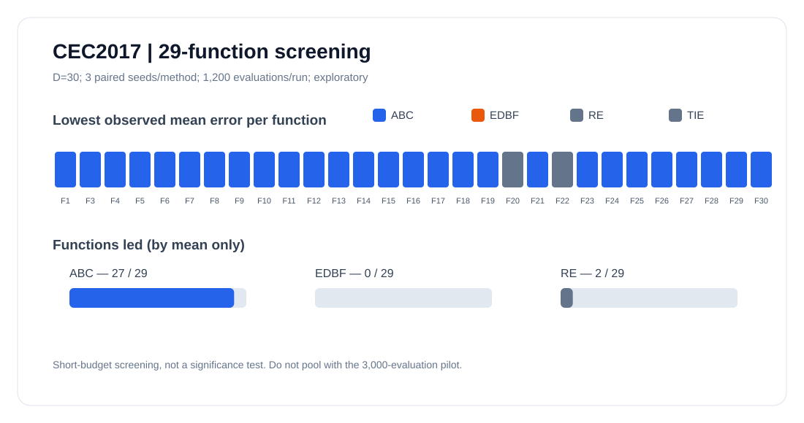

Functions with the lowest observed average error: ABC 27, EDBF 0, RE 2.

[Full screening CSV](docs/experiments/cec2017-screen-30d-2026-10-17/trials.csv) · [per-function means](docs/experiments/cec2017-screen-30d-2026-10-17/summary.csv) · [environment](docs/experiments/cec2017-screen-30d-2026-10-17/environment.json) · [Chinese analysis](docs/experiments/cec2017-screen-30d-2026-10-17/statistical_analysis_CN.md)

**Budget caveat:** This 1,200-evaluation screening must not be pooled with the 3,000-evaluation main result.

<details><summary>Earlier 10D exploratory pilot (different backend; do not pool results)</summary>

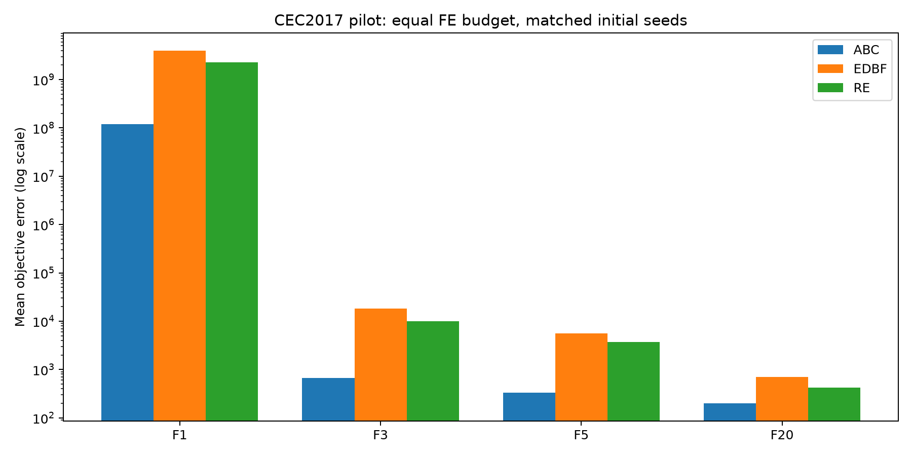

[Pilot raw CSV](docs/experiments/cec2017-pilot-2026-10-17/validation_trials.csv) · [pilot report](docs/experiments/cec2017-pilot-2026-10-17/validation_readme.md)

</details>
<!-- BENCHMARK_RESULTS_END -->

## Overview

BoundEvo focuses on a bottleneck in multi-parent affine recombination: efficiently generating coefficient vectors satisfying

    sum(alpha) = 1
    -0.5 <= alpha_i <= 1.5

The adaptive-boundary generator uses the running coefficient sum to determine the next feasible interval. After generating the first M-1 coefficients, the final coefficient is fixed by the sum constraint. This avoids rejection sampling for the adaptive-boundary method.

The repository keeps three coefficient generators under the same evolutionary engine:

| Method | Generator | Role |
|:---|:---|:---|
| RE | random exhaustive / rejection sampling | EP-GTA-style baseline |
| EDBF | empirical-distribution sampling | improved baseline |
| ABC | adaptive-boundary constraint | BoundEvo default |

## What is included

| Layer | Capability |
|:---|:---|
| Core | Elite preservation, multi-parent affine recombination, bounded-domain repair |
| Coefficients | RE, EDBF, ABC |
| Benchmarks | Sphere, Rosenbrock, Rastrigin, Ackley, CEC2017 |
| Main experiment | 29 CEC2017 functions: F1 and F3-F30 |
| Parent-count study | M=10..16 on F1, F10, F20, F30 |
| Efficiency study | M=1..20 coefficient-generation efficiency |
| Statistics | Mean rank, Win/Tie/Loss, Wilcoxon + Holm, Friedman |
| Reproducibility | JSON run manifests with resolved configuration and environment |
| Reporting | CSV, Markdown tables, PNG plots, standalone HTML report |
| Run comparison | Read-only registry, aligned benchmarks, three-objective Pareto front |
| Validation | Python 3.10/3.11/3.12 CI and CEC2017 smoke tests |

## Installation

Core package:

~~~bash
git clone https://github.com/ZJY-HSBL/BoundEvo.git
cd BoundEvo
pip install -e .
~~~

Full experiment environment:

~~~bash
pip install -e ".[cec2017,analysis,plot]"
~~~

Development:

~~~bash
pip install -e ".[dev]"
ruff check .
pytest
~~~

## Unified CLI

The command-line interface covers the complete experiment-to-report workflow.

~~~bash
boundevo --version
boundevo benchmark --config configs/cec2017.json
boundevo sweep --config configs/parent_sweep.json
boundevo efficiency --config configs/efficiency.json
boundevo analyze --config configs/analysis.json
boundevo report --config configs/report.json
boundevo pipeline --config configs/pipeline.json
boundevo runs --root results/runs
boundevo compare --root results/runs
~~~

The JSON files under <code>configs/</code> are reproducible presets. Command-line overrides are available for common runtime parameters such as dimension, repeats, evaluation budget, seed, and output paths.

For a complete managed run, use <code>boundevo pipeline</code>. It generates a unique Run ID and stores the benchmark, parent-count sweep, efficiency study, statistics, manifests, and final HTML report under one non-overwriting directory:

    results/runs/<run-id>/
    ├── benchmark/
    ├── sweep/
    ├── efficiency/
    ├── analysis/
    ├── report/
    └── manifest.json

## Cross-run comparison

Use `boundevo runs` to inspect completed, incomplete, and invalid experiment bundles. `boundevo compare` compares matched `(function, dimension, method)` benchmark cases and identifies the best run **per criterion** (error, runtime, evaluation count), plus the nondominated Pareto front. Case mismatches are rejected unless you explicitly pass `--allow-partial`.

```bash
boundevo compare --root results/runs \\
  --run-id experiment-001 \\
  --run-id experiment-002 \\
  --output results/comparison.md
```

A Pareto-front run is not automatically the best overall. The comparison reports potential confounders, including differing evaluation budgets, hardware, revisions, and repeat counts. See [Run Registry documentation](docs/run_registry.md).

## Quick Python usage

~~~python
from boundevo import BoundEvo, BoundEvoConfig
from boundevo.benchmarks import make_box_problem

problem = make_box_problem("rastrigin", dimension=10)

optimizer = BoundEvo(
    BoundEvoConfig(
        population_size=100,
        parent_count=15,
        elite_parent_count=5,
        offspring_count=1,
        max_evaluations=50_000,
        seed=42,
    )
)

result = optimizer.minimize(problem)
print(result.objective)
print(result.x)
~~~

## Independent CEC2017 reference backend (development)

A second, explicitly selected benchmark backend now uses the NumPy implementation
adapted from the original CEC2017 C code, pinned to upstream commit
`424a9fa2757914c3e4cfdd8f59a268b1aeb3197f`.

~~~bash
pip install "git+https://github.com/tilleyd/cec2017-py.git@424a9fa2757914c3e4cfdd8f59a268b1aeb3197f"
boundevo benchmark --backend reference --dimension 30 --repeats 10
~~~

The new reference-validation workflow checks the 29 official CEC2017 function
identifiers at D=10 and D=30, then runs a separate 120-trial D=30 comparison
on F1, F3, F10 and F30. Previous opfunu pilot results are **not** pooled with
results from this backend. See [reference backend methodology](docs/reference_backend.md).

## Actual pilot results (October 2026)

A real 60-trial CEC2017 pilot has been executed on F1, F3, F5, and F20 at D=10, 1500 evaluations per trial, with 5 matched initial seeds per method. The three compared coefficient generators are ABC, EDBF, and RE.

[Experimental protocol, numerical results, and caveats](docs/experiments/cec2017-pilot-2026-10-17/validation_readme.md) · [Raw trial CSV](docs/experiments/cec2017-pilot-2026-10-17/validation_trials.csv) · [Summary CSV](docs/experiments/cec2017-pilot-2026-10-17/validation_summary.csv)

**Benchmark integrity warning:** opfunu 1.0.1 produced outcomes below its reported F10 optimum and nonfinite output for F30 at a tested point. F10 and F30 are excluded from the validated pilot. The adapter supports official CEC2017 IDs through a renumbering map, but the full 29-function numerical implementation has NOT been validated. Do not cite the full matrix as reproduced. See [issue #3](https://github.com/ZJY-HSBL/BoundEvo/issues/3).

## Reproduction matrix

The source-aligned main configuration is:

    N = 100
    M = 15
    K = 5
    L = 1

The parent-count study varies <code>M=10..16</code> on F1, F10, F20, and F30 while keeping N=100, K=5, and L=1.

The extracted experiment-setting text does not state benchmark dimensionality. BoundEvo therefore keeps dimension explicit. The supplied presets use dimension 10 as a runnable default, not as a claim about the source experiment.

## Statistical analysis

After producing <code>results/cec2017_summary.csv</code>:

~~~bash
boundevo analyze --config configs/analysis.json
~~~

The generated Markdown report contains average ranks, Win/Tie/Loss counts, two-sided paired Wilcoxon signed-rank tests, Holm-adjusted p-values, and a Friedman omnibus test. The default metric is <code>mean_error</code>, with lower values treated as better.

## Reproducibility manifests and HTML report

Every main CLI stage writes a JSON manifest by default. A manifest records the fully resolved configuration, BoundEvo version, Python runtime, operating platform, relevant dependency versions, source revision when available, and output file locations.

After the experiments and analysis finish:

~~~bash
boundevo report --config configs/report.json
~~~

This creates <code>results/report.html</code>, a self-contained report that can be opened directly in a browser without a Python environment. The report now includes inline SVG convergence curves from sampled optimizer history, M-sensitivity curves from the parent-count sweep, and the coefficient-generation efficiency curve. No JavaScript or plotting runtime is required to view the report.

For long runs, <code>history_interval</code> controls history sampling. The default value of 100 keeps the final state while avoiding one CSV row per generation. The complete pipeline is documented in [docs/research_workflow.md](docs/research_workflow.md).

## Implementation notes

The source ABC flowchart contains an indexing ambiguity around the final coefficient. A literal reading would leave one coefficient undefined. BoundEvo uses the mathematically consistent M-dimensional interpretation: generate M-1 coefficients under adaptive bounds, then compute the M-th coefficient from the sum constraint.

When affine recombination leaves the variable box, offspring are projected back into the domain. This is an explicit implementation choice and is documented rather than silently treated as part of the source method.

## Repository structure

    boundevo/       optimizer, generators, CEC2017, statistics, manifests, reporting, CLI
    configs/        reproducible JSON experiment presets
    docs/           algorithm, reproduction, workflow, and release notes
    examples/       Python usage examples
    scripts/        plotting and standalone experiment utilities
    tests/          unit and integration tests
    .github/        CI and release workflows

## Release

[v0.10.0](https://github.com/ZJY-HSBL/BoundEvo/releases/tag/v0.10.0) is the current published release. See [CHANGELOG.md](CHANGELOG.md) for version history.

## License

MIT License.
