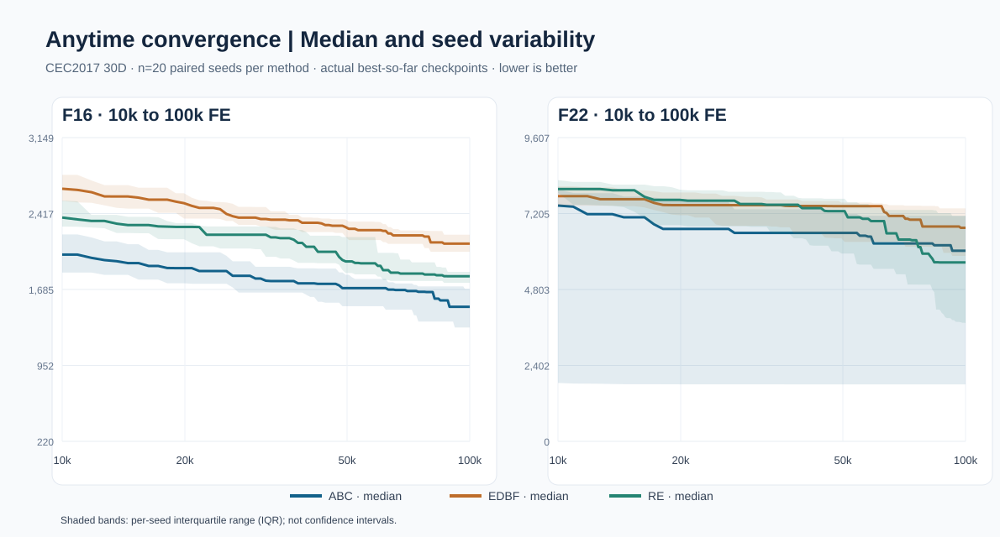
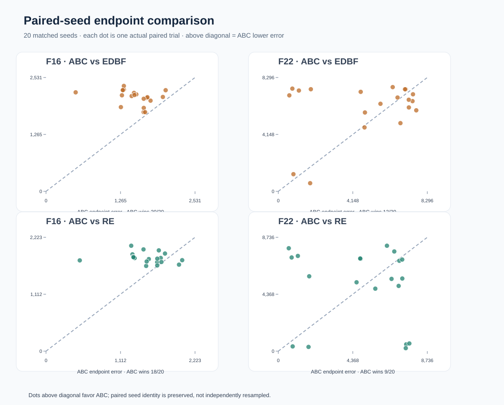
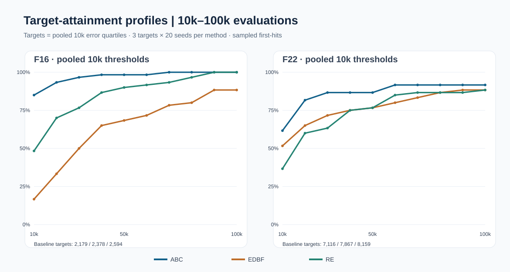
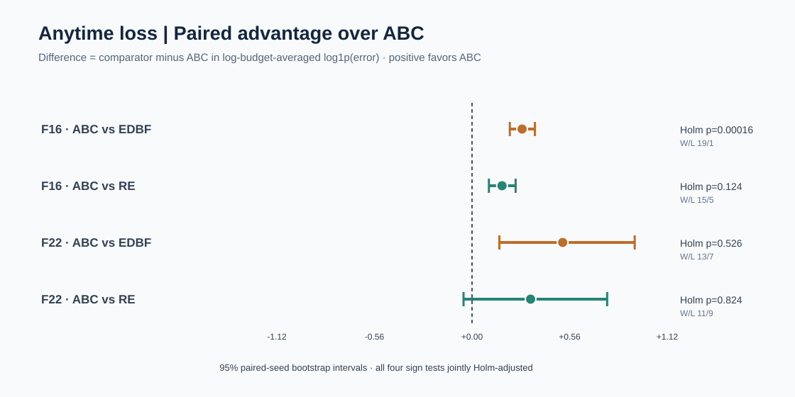
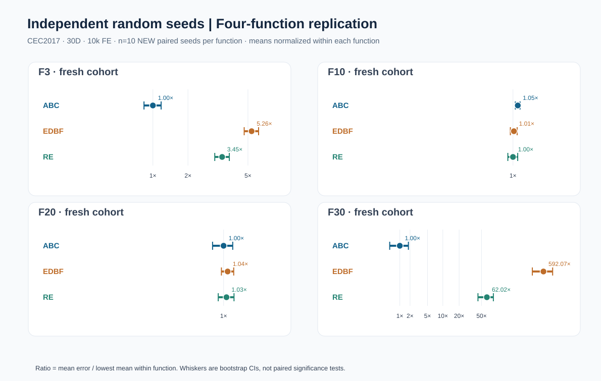
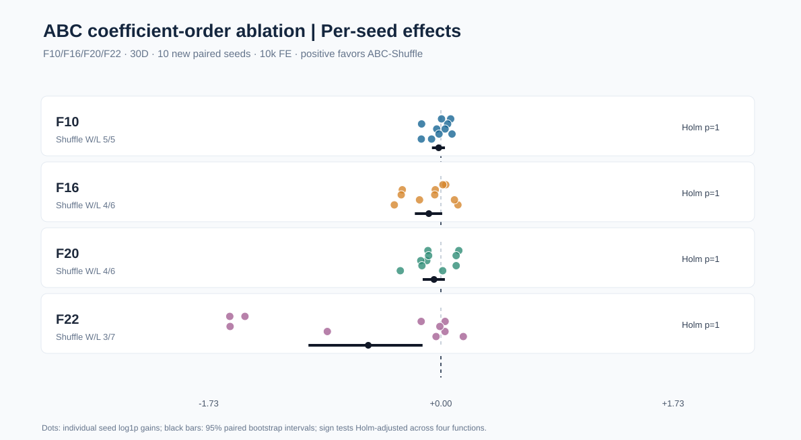

<div align="center">

# BoundEvo

**Adaptive Boundary Evolutionary Optimization｜自适应边界演化优化**

面向实数编码多父体重组的轻量级、可复现实验型 Python 演化优化库。

[](https://github.com/ZJY-HSBL/BoundEvo/actions/workflows/ci.yml)


[English](README.md) · [算法说明](docs/algorithm.md) · [实验复现](docs/reproduction.md) · [研究工作流](docs/research_workflow.md) · [实验索引与对比](docs/run_registry.md) · [v0.11.0 说明](docs/releases/v0.11.0.md)

</div>

<!-- BENCHMARK_RESULTS_START -->
## 真实 CEC2017 实验结果（30 维）

**以下均为真实运行数据，而非模拟结果。** D=30，每次 3,000 次函数评价，每种方法 10 个配对初始种子，共 120 次独立优化试验。同一函数及重复编号下，ABC、EDBF、RE 具有相同的初始化种群。


**最终平均目标误差（越低越好）**

| 测试函数 | ABC | EDBF | RE |
|:---|---:|---:|---:|
| F1 | **1.747e+11** | 7.536e+11 | 4.038e+11 |
| F3 | **84,611.2** | 294,908.6 | 241,204.0 |
| F10 | 8,157.7 | **8,047.6** | 8,174.2 |
| F30 | **4.884e+06** | 1.262e+09 | 3.776e+08 |

实验来源：[120 次原始记录](docs/experiments/cec2017-reference-30d-2026-10-17/trials.csv) · [均值/标准差](docs/experiments/cec2017-reference-30d-2026-10-17/summary.csv) · [配对检验](docs/experiments/cec2017-reference-30d-2026-10-17/paired_sign_tests.csv) · [环境记录](docs/experiments/cec2017-reference-30d-2026-10-17/environment.json) · [中文分析报告](docs/experiments/cec2017-reference-30d-2026-10-17/statistical_analysis_CN.md)

**解释边界：**ABC 在 F1、F3、F30 的平均误差最低，**F10 则由 EDBF 略优**。这只能说明当前所测函数与预算下的表现，不能推导出对全部函数的普遍优势。独立 Python 后端并非原始官方 C 程序；58/58 项仅为有限采样点的数值预检，且每次 3,000 次评价不等于论文级完整复现。

### 100k 评价预算：20 配对种子扩展验证

**120 次真实优化试验。** F16/F22、30 维、ABC/EDBF/RE、每法 20 个配对种子，由此前 10k 实测轨迹扩展到 100k；前 5 种子复用 已经验证的 100k 试验，仅新计算编号 5–19。


| 函数 | 方法 | 10k 均值误差 | 100k 均值误差 | Bootstrap 95% 区间 |
|:---|:---|---:|---:|:---|
| F16 | ABC | 2,050.7 | 1,509.1 | [1,362.9, 1,640.2] |
| F16 | EDBF | 2,636.3 | 2,094.0 | [2,018.6, 2,161.9] |
| F16 | RE | 2,391.3 | 1,817.9 | [1,775.1, 1,863.5] |
| F22 | ABC | 5,755.3 | 4,900.7 | [3,701.8, 6,024.3] |
| F22 | EDBF | 7,571.2 | 6,087.9 | [5,183.5, 6,830.4] |
| F22 | RE | 7,791.6 | 5,012.8 | [3,737.3, 6,205.7] |

| 函数 | 配对比较 | ABC 胜/负/平 | Holm 校正 p |
|:---|:---|---:|---:|
| F16 | abc_vs_edbf | 20/0/0 | 7.62939e-06 |
| F16 | abc_vs_re | 18/2/0 | 0.00120735 |
| F22 | abc_vs_edbf | 12/8/0 | 1 |
| F22 | abc_vs_re | 9/11/0 | 1 |

**研究边界：**在观察到 F22 的五种子结果离散程度很高之后才决定 从 5 种子扩展到 20 种子。因此这属于自适应探索，不是新的 独立测试种子；本轮四项比较的 Holm 校正不能消除此前选题与扩容偏差。

[120 条原始数据](docs/experiments/cec2017-paperbudget-30d-100k-20seeds-2026-10-19/trials.csv) · [收敛轨迹](docs/experiments/cec2017-paperbudget-30d-100k-20seeds-2026-10-19/history.csv) · [Holm 检验](docs/experiments/cec2017-paperbudget-30d-100k-20seeds-2026-10-19/paired_tests.csv) · [完整分析](docs/experiments/cec2017-paperbudget-30d-100k-20seeds-2026-10-19/report.md)


### 接近原论文评价预算：100,000 次函数评价

**30 次真实优化试验**：F16/F22，30 维，每种算法使用先前 20 种子中的 5 个相同种子。10k 时刻与此前实测结果逐一核对。


| 函数 | 方法 | 10k 均值误差 | 100k 均值误差 | 相对变化 |
|:---|:---|---:|---:|---:|
| F16 | ABC | 2,341.1 | 1,732.4 | +26.00% |
| F16 | EDBF | 2,577.7 | 2,076.1 | +19.46% |
| F16 | RE | 2,381.9 | 1,797.7 | +24.53% |
| F22 | ABC | 6,170.2 | 5,780.2 | +6.32% |
| F22 | EDBF | 7,879.7 | 7,155.4 | +9.19% |
| F22 | RE | 7,981.5 | 5,180.4 | +35.10% |

[30 次原始记录](docs/experiments/cec2017-paperbudget-30d-100k-2026-10-18/trials.csv) · [真实收敛过程](docs/experiments/cec2017-paperbudget-30d-100k-2026-10-18/history.csv) · [环境和来源](docs/experiments/cec2017-paperbudget-30d-100k-2026-10-18/environment.json) · [实验分析](docs/experiments/cec2017-paperbudget-30d-100k-2026-10-18/report.md)

**局限：**仅两个函数和五个配对种子。100k 评价预算与原论文上限一致，但并非完整 29 函数原论文复现。

### F16、F22：新增 20 个独立种子验证算法排名

**120 次全新实测试验**：F16、F22，30 维，每次 10,000 次函数评价，每种算法 20 个此前实验没有使用过的配对种子。


**平均目标误差及 95% 百分位 Bootstrap 区间（越低越好）：**

| 函数 | 方法 | 平均误差 | Bootstrap 95% 区间 |
|:---|:---|---:|:---|
| F16 | ABC | 2,050.7 | [1,934.4, 2,172.8] |
| F16 | EDBF | 2,636.3 | [2,548.6, 2,715.5] |
| F16 | RE | 2,391.3 | [2,296.2, 2,471.8] |
| F22 | ABC | 5,755.3 | [4,392.0, 7,056.6] |
| F22 | EDBF | 7,571.2 | [7,137.0, 7,890.0] |
| F22 | RE | 7,791.6 | [7,395.5, 8,097.8] |

**不同随机种子批次的均值领先方法变化**（各批数据不合并）：

| 函数 | 先前 3 种子 | 先前 10 种子 | 新增 20 种子 |
|:---|:---|:---|:---|
| F16 | RE | — | ABC |
| F22 | EDBF | ABC | ABC |

**双侧配对精确符号检验（4 项比较统一 Holm 校正）：**

| 函数 | 对照 | ABC 胜/负/平 | Holm 校正 p |
|:---|:---|---:|---:|
| F16 | abc_vs_edbf | 19/1/0 | 0.00016022 |
| F16 | abc_vs_re | 16/4/0 | 0.035454 |
| F22 | abc_vs_edbf | 13/7/0 | 0.26318 |
| F22 | abc_vs_re | 14/6/0 | 0.23064 |

[120 次原始实测](docs/experiments/cec2017-holdout-30d-10k-2026-10-17/trials.csv) · [Bootstrap 统计表](docs/experiments/cec2017-holdout-30d-10k-2026-10-17/summary.csv) · [配对检验](docs/experiments/cec2017-holdout-30d-10k-2026-10-17/paired_tests.csv) · [随机种子与环境](docs/experiments/cec2017-holdout-30d-10k-2026-10-17/environment.json) · [完整实验报告](docs/experiments/cec2017-holdout-30d-10k-2026-10-17/report.md)

**解释边界：**F16、F22 是此前发现排名分歧后选定的函数；新种子避免了重复使用旧数据，但本轮仍属于两函数探索性实验。

### 全部 29 个函数：10,000 次评价与收敛曲线

**261 次真实优化试验**，CEC2017 30 维，每方法 3 个配对种子。每函数重复次数仍较少，结果仅用于探索性比较。


观测平均目标误差最低的函数数目：ABC 27, EDBF 1, RE 1.

**跨函数配对 Wilcoxon 检验**（对各函数平均误差取 log10，两项比较统一 Holm 校正）：

| 对照 | ABC 领先/落后 | 原始 p | Holm 校正 p |
|:---|---:|---:|---:|
| abc_vs_edbf | 28/1 | 7.4506e-09 | 1.4901e-08 |
| abc_vs_re | 28/1 | 1.1176e-08 | 1.4901e-08 |

<details><summary>展开查看全部 29 个函数的真实平均误差</summary>

| 函数 | ABC | EDBF | RE |
|:---|---:|---:|---:|
| F1 | **1.321e+11** | 3.331e+11 | 1.537e+11 |
| F3 | **31,980.2** | 275,529.3 | 145,773.4 |
| F4 | **915.1** | 7,212.7 | 1,048.8 |
| F5 | **279.5** | 419.5 | 317.7 |
| F6 | **48.2** | 100.6 | 71.6 |
| F7 | **441.7** | 1,754.9 | 693.4 |
| F8 | **273.2** | 402.4 | 318.5 |
| F9 | **3,853.2** | 18,373.9 | 9,431.4 |
| F10 | **7,300.6** | 7,715.9 | 7,773.1 |
| F11 | **281.8** | 3,532.0 | 691.5 |
| F12 | **2.247e+07** | 1.373e+10 | 2.408e+09 |
| F13 | **16,042.5** | 2.463e+09 | 2.624e+07 |
| F14 | **295.6** | 19,196.9 | 435.4 |
| F15 | **810.3** | 1.470e+07 | 50,695.6 |
| F16 | 2,327.5 | 2,610.2 | **2,257.3** |
| F17 | **883.3** | 1,368.5 | 1,125.7 |
| F18 | **406.7** | 5.193e+06 | 757,108.7 |
| F19 | **206.6** | 5.637e+07 | 1.350e+06 |
| F20 | **682.2** | 1,188.4 | 953.3 |
| F21 | **458.6** | 589.1 | 486.1 |
| F22 | 7,889.5 | **7,725.8** | 7,904.8 |
| F23 | **694.9** | 809.1 | 728.5 |
| F24 | **763.2** | 841.2 | 828.4 |
| F25 | **736.0** | 3,931.1 | 1,013.2 |
| F26 | **4,284.3** | 6,036.8 | 4,558.3 |
| F27 | **568.8** | 633.5 | 593.4 |
| F28 | **1,129.9** | 2,898.3 | 1,302.0 |
| F29 | **1,310.6** | 1,925.1 | 1,920.1 |
| F30 | **459,541.4** | 6.323e+07 | 4.889e+06 |

</details>


[261 条原始试验](docs/experiments/cec2017-fullsuite-30d-10k-2026-10-17/trials.csv) · [收敛历史](docs/experiments/cec2017-fullsuite-30d-10k-2026-10-17/history.csv) · [逐函数汇总](docs/experiments/cec2017-fullsuite-30d-10k-2026-10-17/summary.csv) · [统计报告](docs/experiments/cec2017-fullsuite-30d-10k-2026-10-17/report.md) · [环境与源码修订](docs/experiments/cec2017-fullsuite-30d-10k-2026-10-17/environment.json)

**适用范围：**这是全部 29 函数的 10k 次评价探索实验，不是原论文 100k 次评价的完整复现。不同预算、不同基准实现的数据不得混合统计。


在 29 个函数中，有 3 个函数在 1,200 与 10,000 次评价之间更换了观测均值领先的方法。


### 高评价预算验证：每次 10,000 次函数评价

**120 次真实试验**，D=30，测试 F10、F20、F22、F30，每方法 10 个配对初始种子。重点检验此前 ABC 未领先的函数。


| 函数 | ABC | EDBF | RE |
|:---|---:|---:|---:|
| F10 | **7,470.2** | 7,501.9 | 7,661.9 |
| F20 | **785.2** | 1,129.8 | 1,049.5 |
| F22 | **5,717.6** | 7,651.5 | 7,300.1 |
| F30 | **188,044.0** | 6.193e+07 | 5.511e+06 |

**跨预算验证**（同一参考后端与种子规则，3,000 → 10,000 次评价）：

| 函数 | 方法 | 3k 次评价误差 | 10k 次评价误差 |
|:---|:---|---:|---:|
| F10 | ABC | 8,157.7 | 7,470.2 |
| F10 | EDBF | 8,047.6 | 7,501.9 |
| F10 | RE | 8,174.2 | 7,661.9 |
| F30 | ABC | 4.884e+06 | 188,044.0 |
| F30 | EDBF | 1.262e+09 | 6.193e+07 |
| F30 | RE | 3.776e+08 | 5.511e+06 |

**配对精确符号检验（全部 8 项统一 Holm 校正，仅探索性）：**

| 函数 | 对照 | ABC 胜/负/平 | 原始 p | Holm 校正 p |
|:---|:---|---:|---:|---:|
| F10 | ABC vs EDBF | 4/6/0 | 0.75391 | 1 |
| F10 | ABC vs RE | 5/4/1 | 1 | 1 |
| F20 | ABC vs EDBF | 10/0/0 | 0.0019531 | 0.015625 |
| F20 | ABC vs RE | 10/0/0 | 0.0019531 | 0.015625 |
| F22 | ABC vs EDBF | 7/3/0 | 0.34375 | 1 |
| F22 | ABC vs RE | 7/3/0 | 0.34375 | 1 |
| F30 | ABC vs EDBF | 10/0/0 | 0.0019531 | 0.015625 |
| F30 | ABC vs RE | 10/0/0 | 0.0019531 | 0.015625 |

四个函数共 40 组配对种子中 ABC 的获胜次数（不计平局）：vs EDBF 31/40; vs RE 32/40.

[120 次原始试验](docs/experiments/cec2017-longbudget-30d-2026-10-17/trials.csv) · [均值和方差](docs/experiments/cec2017-longbudget-30d-2026-10-17/summary.csv) · [配对检验](docs/experiments/cec2017-longbudget-30d-2026-10-17/paired_sign_tests.csv) · [环境记录](docs/experiments/cec2017-longbudget-30d-2026-10-17/environment.json) · [中文分析报告](docs/experiments/cec2017-longbudget-30d-2026-10-17/statistical_analysis_CN.md)

**解释边界：**这只是选定四函数的高预算试验，不是完整 29 函数的 10k 次评价复现。不同预算不能合并统计，均值领先不等于显著优势。

### 全部 29 个函数：30 维探索性普查

共 **261 次真实试验**；每种方法 3 个配对种子、每次 1,200 次函数评价。颜色只表示观测均值最低，并不表示统计显著。


获得最低观测平均误差的函数数量：ABC 27, EDBF 0, RE 2.

[261 条原始记录](docs/experiments/cec2017-screen-30d-2026-10-17/trials.csv) · [逐函数均值](docs/experiments/cec2017-screen-30d-2026-10-17/summary.csv) · [实验环境](docs/experiments/cec2017-screen-30d-2026-10-17/environment.json) · [中文结果分析](docs/experiments/cec2017-screen-30d-2026-10-17/statistical_analysis_CN.md)

**预算限制：**本轮 1,200 次评价的普查结果不得与前述 3,000 次评价的实验合并统计。

<details><summary>更早的 10 维探索性实验（使用另一后端，数据不得混合统计）</summary>


[10 维原始数据](docs/experiments/cec2017-pilot-2026-10-17/validation_trials.csv) · [试验说明](docs/experiments/cec2017-pilot-2026-10-17/validation_readme.md)

</details>
<!-- BENCHMARK_RESULTS_END -->

<!-- ADVANCED_RESEARCH_START -->
## 下一阶段研究：长预算过程表现与独立随机种子复核

这部分继续分析 **120 次真实 100k-FE 试验**，不把二次统计写成新的训练或实验次数。
新的研究指标为对数评价预算上的样本保持积分，衡量 10k 到 100k 的全过程误差；越低越好。均值终点和全过程排名可能不同。





**全过程误差：平均 log1p 误差积分**

| 函数 | ABC | EDBF | RE |
|:---|---:|---:|---:|
| F16 | **7.4796** | 7.7680 | 7.6524 |
| F22 | **8.2842** | 8.8065 | 8.6216 |





### 全新随机种子：四函数复核（10k FE）

本组新实验与上述已完成的 100k 轨迹分析严格分开：F3/F10/F20/F30，每函数 10 个全新配对种子，三种方法，共 120 次额外真实试验。



[原始实验与报告](docs/experiments/cec2017-fresh-functions-30d-10k-2026-10-20/report.md)

### 新的机制消融：ABC 系数顺序是否影响性能？

ABC-Shuffle 保留原 ABC 生成的所有系数，只随机置换它们在父代中的位置；新随机种子、原配置、相同初始种群，80 次真实试验。



| 函数 | ABC 平均误差 | ABC-Shuffle 平均误差 | Holm p |
|:---|---:|---:|---:|
| F10 | 7,559.44 | 7,678.01 | 1 |
| F16 | 1,995.37 | 2,177.90 | 1 |
| F20 | 1,009.08 | 1,061.83 | 1 |
| F22 | 5,484.03 | 7,523.93 | 1 |

**解释限制：**四项平均误差均有利于原 ABC，但 Holm 校正的配对符号检验均不显著。该机制尚未得到确证，且额外置换会改变后续随机数序列。

[消融设计](docs/abc_shuffle_ablation_protocol.md) · [80 次原始记录及分析报告](docs/experiments/cec2017-abc-shuffle-30d-10k-2026-10-20/report.md)

**边界：**F16/F22 的 20 种子扩容是观察初步结果后的适应性研究，新全过程统计不等于独立确认。目标阈值来自既有 10k 样本；所有比较均应按函数、评价预算分别解释。

[全过程研究数据与统计报告](docs/experiments/cec2017-anytime-30d-100k-20seeds-2026-10-20/report.md)

<!-- ADVANCED_RESEARCH_END -->

## 项目定位

BoundEvo 解决多父体仿射重组中的一个核心问题：高效生成满足下列条件的系数向量。

    sum(alpha) = 1
    -0.5 <= alpha_i <= 1.5

自适应边界方法根据当前累计和动态计算下一个系数的可行区间。先生成前 M-1 个系数，再通过总和约束确定最后一个系数，因此 ABC 方法不需要拒绝采样。

仓库在同一套演化优化框架中保留三类系数生成方法：

| 方法 | 系数生成方式 | 定位 |
|:---|:---|:---|
| RE | 随机穷举 / 拒绝采样 | EP-GTA 风格基线 |
| EDBF | 经验概率分布采样 | 改进基线 |
| ABC | 自适应边界约束 | BoundEvo 默认方法 |

## 当前能力

| 层级 | 已实现内容 |
|:---|:---|
| 算法核心 | 精英保留、多父体仿射重组、有界域修复 |
| 系数生成 | RE、EDBF、ABC |
| Benchmark | Sphere、Rosenbrock、Rastrigin、Ackley、CEC2017 |
| 主实验 | CEC2017 共 29 个函数：F1 与 F3-F30 |
| M 消融 | F1、F10、F20、F30 上 M=10..16 |
| 效率实验 | M=1..20 系数向量生成效率 |
| 统计分析 | 平均排名、Win/Tie/Loss、Wilcoxon + Holm、Friedman |
| 可复现性 | 自动记录完整配置、运行环境和源码版本的 JSON Manifest |
| 输出 | CSV、Markdown、PNG、自包含 HTML 实验报告 |
| 跨实验比较 | Run Registry、测试项对齐、三目标 Pareto 前沿 |
| 验证 | Python 3.10/3.11/3.12 CI 与真实 CEC2017 smoke test |

## 安装

仅使用核心算法：

~~~bash
git clone https://github.com/ZJY-HSBL/BoundEvo.git
cd BoundEvo
pip install -e .
~~~

完整实验环境：

~~~bash
pip install -e ".[cec2017,analysis,plot]"
~~~

开发与测试：

~~~bash
pip install -e ".[dev]"
ruff check .
pytest
~~~

## 统一命令行

当前命令行已经覆盖“实验 → 统计 → 报告”的完整流程：

~~~bash
boundevo --version
boundevo benchmark --config configs/cec2017.json
boundevo sweep --config configs/parent_sweep.json
boundevo efficiency --config configs/efficiency.json
boundevo analyze --config configs/analysis.json
boundevo report --config configs/report.json
boundevo pipeline --config configs/pipeline.json
boundevo runs --root results/runs
boundevo compare --root results/runs
~~~

<code>configs/</code> 中的 JSON 文件用于固定实验参数，避免每次手工输入导致配置漂移。常用参数仍可以直接通过命令行覆盖。

需要一次性执行完整研究流程时，可以直接运行 <code>boundevo pipeline</code>。程序会生成唯一 Run ID，并将该次实验的主实验、M 消融、系数效率、统计检验、Manifest 和最终 HTML 报告统一保存到一个不可覆盖的目录：

    results/runs/<run-id>/
    ├── benchmark/
    ├── sweep/
    ├── efficiency/
    ├── analysis/
    ├── report/
    └── manifest.json

## 历史实验检索与比较

`boundevo runs` 可查看已完成、未完成及文件异常的实验目录；`boundevo compare` 只按相同的 `(测试函数、维度、算法)` 条目对齐计算，分别选出目标误差、运行时间、评价次数三个指标的领先实验，并给出非支配 Pareto 前沿。如果测试项不一致，默认拒绝比较，只有显式指定 `--allow-partial` 才按交集分析。

```bash
boundevo compare --root results/runs \\
  --run-id experiment-001 \\
  --run-id experiment-002 \\
  --output results/comparison.md
```

**Pareto 非支配不等于综合最优**。不同硬件、计算预算、代码版本及重复次数均可能影响比较结果，具体规则见[实验索引与对比文档](docs/run_registry.md)。

## Python 快速使用

~~~python
from boundevo import BoundEvo, BoundEvoConfig
from boundevo.benchmarks import make_box_problem

problem = make_box_problem("rastrigin", dimension=10)

optimizer = BoundEvo(
    BoundEvoConfig(
        population_size=100,
        parent_count=15,
        elite_parent_count=5,
        offspring_count=1,
        max_evaluations=50_000,
        seed=42,
    )
)

result = optimizer.minimize(problem)
print(result.objective)
print(result.x)
~~~

## 独立 CEC2017 基准后端（开发中）

目前新增了一个独立可选的 CEC2017 实现，它由原始 C 代码改写为 NumPy，固定使用上游提交 `424a9fa2757914c3e4cfdd8f59a268b1aeb3197f`，保留官方函数编号。

~~~bash
pip install "git+https://github.com/tilleyd/cec2017-py.git@424a9fa2757914c3e4cfdd8f59a268b1aeb3197f"
boundevo benchmark --backend reference --dimension 30 --repeats 10
~~~

独立验证流程在 10 维和 30 维检查全部 29 个官方函数编号，再在 F1、F3、F10、F30 上进行 120 组 30 维对照试验。不同后端的数值不会混入同一统计结果。详见[独立基准验证说明](docs/reference_backend.md)。

## 真实数值验证（2026 年 10 月）

已在 GitHub Actions 上完成一轮 60 组真实试验：CEC2017 F1、F3、F5、F20，10 维，每组最多 1500 次函数评价；ABC、EDBF、RE 各重复 5 次，相同函数及重复编号使用相同初始种子。

[完整实验记录与结论](docs/experiments/cec2017-pilot-2026-10-17/validation_readme.md) · [原始 CSV](docs/experiments/cec2017-pilot-2026-10-17/validation_trials.csv) · [汇总 CSV](docs/experiments/cec2017-pilot-2026-10-17/validation_summary.csv)

**基准实现完整性警告：**实测 opfunu 1.0.1 的 F10 曾出现低于声明最优值的目标值，F30 在一个测试点出现非有限输出。本轮不采用这两个函数，当前也不能宣称已经完成全部 29 个函数的正式数值复现。相关问题见 [Issue #3](https://github.com/ZJY-HSBL/BoundEvo/issues/3)。

## 实验复现矩阵

主实验按以下参数封装：

    N = 100
    M = 15
    K = 5
    L = 1

M 消融固定 N=100、K=5、L=1，并在 F1、F10、F20、F30 上测试 <code>M=10..16</code>。

当前提取到的实验设置文字没有明确给出 CEC2017 测试维度，因此本仓库没有把维度写成“原实验固定参数”。配置文件默认使用 10 维，只作为可直接运行的默认值，维度始终可以显式修改。

## 统计分析

生成 <code>results/cec2017_summary.csv</code> 后运行：

~~~bash
boundevo analyze --config configs/analysis.json
~~~

自动得到平均排名、Win/Tie/Loss、双侧配对 Wilcoxon 符号秩检验、Holm 多重比较校正以及 Friedman 总体检验。默认使用 <code>mean_error</code>，并按“越小越好”处理。

## 可复现实验清单与 HTML 报告

现在每个主要 CLI 阶段都会自动写出 JSON Manifest，记录最终生效的参数、BoundEvo 版本、Python 版本、运行平台、NumPy/SciPy/opfunu/Matplotlib 版本、可获取的源码提交 SHA 以及输出文件位置。

完成实验与统计后运行：

~~~bash
boundevo report --config configs/report.json
~~~

会生成 <code>results/report.html</code>。这是一个单文件、自包含的实验报告，直接用浏览器即可查看，不依赖 Python 环境。当前报告已经能够直接绘制采样后的收敛曲线、M 参数敏感性曲线以及系数生成效率曲线，图形以内联 SVG 写入 HTML，不需要 JavaScript 或额外绘图库才能查看。

长时间实验通过 <code>history_interval</code> 控制历史采样，默认每 100 代记录一次，同时始终保留最终状态，避免把每一代都写入 CSV 导致结果文件过大。完整研究流程见 [docs/research_workflow.md](docs/research_workflow.md)。

## 实现边界

源材料的 ABC 流程图在最后一个系数的下标处存在歧义。若完全按字面执行，会出现一个系数未定义。BoundEvo 采用与 M 维系数向量及总和约束一致的解释：先生成 M-1 个系数，再由总和约束计算第 M 个系数。

多父体仿射重组产生越界子代时，本仓库采用投影裁剪回变量定义域。这属于明确记录的工程实现选择，不将其静默描述为源方法本身。

## 仓库结构

    boundevo/       优化器、系数生成、CEC2017、统计、Manifest、报告、CLI
    configs/        可复现实验 JSON 配置
    docs/           算法、复现、工作流与 Release 文档
    examples/       Python 使用示例
    scripts/        绘图和独立实验工具
    tests/          单元测试与集成测试
    .github/        CI 与 Release 工作流

## Release

[v0.10.0](https://github.com/ZJY-HSBL/BoundEvo/releases/tag/v0.10.0) 为当前正式版本。完整版本记录见 [CHANGELOG.md](CHANGELOG.md)。

## License

MIT License。
